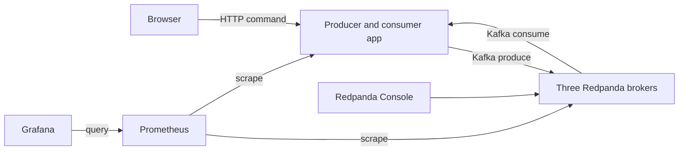

# How the explorer works

The broker log is the source of truth for records and committed consumer offsets. The app's counters and recent event list are process-local views, not a durable database.

## Why three brokers?

`lab.events` has six partitions and replication factor three. Each partition has a leader and replicas on the other brokers. This supports the broker-failure experiment: one process can stop while a majority remains available. All processes live on one host and share its failure domain, so this is not a multi-zone deployment.

The brokers run `--mode=dev-container`, each with `--smp=1`, `--memory=1G`, and no reserved memory. These are local learning settings, not production sizing recommendations.

## Why separate listeners?

Inside the private Compose network, services reach `redpanda-0:9092` through `redpanda-2:9092`. Host Kafka clients use the printed loopback ports. Advertised addresses must match where the client can connect; publishing a socket alone does not make an internal broker name reachable from the host.

Schema Registry and the HTTP Proxy run on broker zero. Console can inspect topics, consumer groups, schemas, and the Admin API. Prometheus scrapes the brokers' public metrics and the app every five seconds. Grafana ships a provisioned dashboard, so there is nothing to import manually.

## Who owns the resources?

`lab` derives a Compose project name from the checkout's absolute path. It stores the port allocation and lifecycle lock under `${XDG_CACHE_HOME:-$HOME/.cache}/redpanda-lab/`. Containers own named data volumes; the repository holds only source/configuration. A moved checkout has a different identity. Dispose of the old checkout's lab before moving it, or retain its original path for cleanup.

`up` and `down` serialize through `flock`. Container processes must not inherit the lock descriptor. Ports are probed before startup; another process can still bind between the probe and Compose. A bind failure is an error to diagnose, not permission to stop another process.
