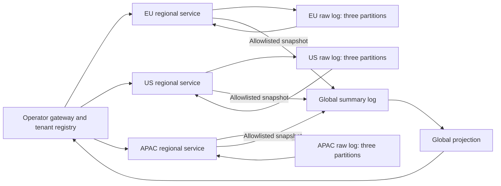

# Multi-jurisdiction sharding

Run three independent regional event logs and a fourth cluster for global summaries. Publish synthetic tenant records, inspect their partition and offset, stop a region, and see why residency-aware systems do not automatically redirect private writes to another jurisdiction.

This is a **single-host architecture experiment**, not a multi-region deployment, compliance certification, or disaster-recovery system. EU, US and APAC are illustrative routing labels, not legal determinations. For example, this fixture groups Canadian and US tenants together; a real policy may require separate clusters.

## Start and publish a record

Use the Linux/rootless Podman prerequisites in the [getting-started guide](../index.md). Allow several GiB for four brokers and five small application containers. No cloud credentials are needed.

```bash
nix develop --no-update-lock-file
just up jurisdictions
just urls jurisdictions
```

Open the printed operator URL. Select a tenant, enter synthetic units and a private note, then choose **Publish to home region**. The placement line shows the jurisdiction, regional partition and Kafka key before submission. Completion shows the consumed offset. Open **Inspect regional private records** to find the note, then compare the global summary table. The note and tenant ID do not appear in exported summaries.

The gateway is an unauthenticated operator tool with access to every region. Its regional inspection view deliberately returns private fixtures to the browser. The *global consumer service* and its broker have no regional broker network attachment; the operator gateway does. This is not tenant authorization or prevention of exfiltration by a compromised regional exporter.

## Understand the two levels of partitioning

1. **Jurisdiction sharding** selects an independent cluster from server-owned tenant residency. Raw records and broker volumes remain in that cluster.
2. **Kafka partitioning** selects an ordered log inside the home cluster. The lab hashes the UTF-8 tenant ID with SHA-256, reads the first four bytes as an unsigned big-endian integer, and takes the remainder modulo three. Each write explicitly supplies that partition and uses the tenant ID as its Kafka key.

| Fixture tenants | Home cluster | Raw topic | Partitions |
| --- | --- | --- | --- |
| `berlin-shop` (DE), `paris-shop` (FR), `dublin-shop` (IE) | `eu` | `jurisdictions.records.v1` | 3 |
| `new-york-shop` (US), `toronto-shop` (CA) | `us` | `jurisdictions.records.v1` | 3 |
| `singapore-shop` (SG), `tokyo-shop` (JP) | `apac` | `jurisdictions.records.v1` | 3 |
| Aggregate snapshots only | `global` | `jurisdictions.summaries.v1` | 3, one per source region |

Each cluster has one broker and replication factor 1. Identical regional topic names do not make the clusters share data. A partition is not a jurisdiction, an availability zone, or a backup. Keys give stable ordering within a partition, not a total order across regions or partitions. A fixed three-partition scheme makes placement easy to inspect; adding partitions would change this hash mapping. Changing the registry or partition count requires a deliberate migration, not an environment-variable override.



## See what crosses the boundary

Regional services consume their complete raw history and build partition counters. A separate exporter sends cumulative snapshots, constructed from exactly these fields:

| Field | Meaning |
| --- | --- |
| `region` | Source jurisdiction label. |
| `partition` | Source regional partition, 0 through 2. |
| `sourceOffset` | Last consumed raw offset, represented as a decimal string. |
| `count` | Number of unique applied operations in that partition. |
| `totalAmount` | Sum of synthetic units for those operations. |

The export key is `region:partition`. All summaries from one region use the region's designated global partition. The global projection keeps the highest source offset for each regional partition and replaces its cumulative totals. It does not sum successive snapshots. Duplicate exports and regional replay therefore do not count the same input twice. Offsets from different logs are not comparable; freshness is relative to a source partition, not a global timestamp.

Exports are asynchronous, allowlisted application-level federation, not MirrorMaker, Redpanda cluster linking, raw-topic replication, or a distributed transaction. The regional raw log acts as the export outbox: replay can regenerate the latest snapshots after a restart. A global outage does not block regional consumption or new local writes. While unavailable, the global view retains its last projection; it must not be mistaken for current regional truth.

The field filter is a demonstration policy. Even counts and totals can identify people in small populations. Production exports need jurisdiction-specific approval, aggregation thresholds, authorization, audit and a privacy review. Network separation alone does not enforce a field-level export policy.

## Exercise failures

Stop the EU broker while keeping the gateway and other regions running:

```bash
./labs/run jurisdictions outage eu
```

Publish a new EU record. The API refuses it with `503` and `outcome: not-attempted` when its preflight observes the unavailable home broker. Publish US and APAC records; their clusters continue independently. There is no alternate-region placement. Recover the broker, then publish another EU record:

```bash
./labs/run jurisdictions recover eu
```

To interrupt federation instead, stop the global broker, publish regional records, then recover it:

```bash
./labs/run jurisdictions outage global
./labs/run jurisdictions recover global
```

Regional exporters report unavailability, then catch up with their latest snapshots. A broker failure during an in-flight write is different from the preflight refusal: acknowledgement failure leaves completion **unknown**. Look up the stable operation ID before deciding whether to retry. The lab does not promise a rollback.

## API and inspection reference

Get the actual URL, then publish a complete synthetic fixture:

```bash
APP=$(./labs/run jurisdictions urls --json | jq -r .app)
curl -fsS "$APP/api/events" \
  -H 'Content-Type: application/json' \
  -d '{"id":"example-eu-001","tenantId":"berlin-shop","amount":125,"privateNote":"Synthetic reference only"}'
curl -fsS "$APP/api/operations/eu/example-eu-001"
curl -fsS "$APP/api/state" | jq .global
just rpk jurisdictions eu topic describe jurisdictions.records.v1 -p
just rpk jurisdictions global topic describe jurisdictions.summaries.v1 -p
```

`id` is a stable 1–100 character identifier using letters, digits, underscores or hyphens. `amount` is an integer from 1 through 1,000,000 synthetic units. `privateNote` is a string up to 240 characters. Unknown tenants are rejected. An optional `requestedRegion` must match registered residency, otherwise the API returns `409` without publication. The regional endpoint independently checks the home region.

| Endpoint | Result |
| --- | --- |
| `POST /api/events` | `200` applied, `202` pending, `400` invalid input, `409` conflicting ID/region, `503` unavailable or unknown acknowledgement. |
| `GET /api/operations/REGION/ID` | The home-region operation and placement; `404` means not observed by that running projection, not proof of absence during an interrupted write. |
| `GET /api/state` | Operator registry, regional availability/projections, export state and global summaries. |
| `GET /health` | Gateway process readiness; use `/api/state` to inspect each cluster. |

When the home service and broker are available, reusing an ID with identical input returns the existing operation, without another write. Different input with that ID is rejected, including concurrent submissions. Deduplication is local to a jurisdiction; reuse is not a cross-region transaction. The regional consumer also deduplicates raw records by ID during replay. It fails rather than accepting a conflicting command in the authoritative log. The demonstration assumes one regional service per home cluster.

If an operation stays unknown, inspect its home-region logs and broker records. After broker recovery, restart the regional service to finish a full replay before interpreting absence or reusing the original ID and input. The browser retains the outstanding ID on the current page and prevents another submission while unresolved; it does not durably retain it across page reloads.

```bash
just logs jurisdictions region-eu
just restart jurisdictions region-eu
just restart jurisdictions global
```

Use `just exec jurisdictions SERVICE COMMAND...` for container inspection. Services are `app`, `region-eu`, `region-us`, `region-apac`, `global`, and `broker-eu`, `broker-us`, `broker-apac`, `broker-global`. `rpk` requires `eu`, `us`, `apac` or `global` before its arguments. Only the gateway port is published; Kafka and Admin APIs stay on the owned container networks. Set `LAB_PORT_BASE` to a free port from 49152 through 65535 before first startup, if needed. The selected port persists until successful disposal.

## Verify and dispose

**The E2E command deletes this lab's existing history.** It starts a fresh deployment, checks placement and raw broker records, stable ordering, duplicate/conflicting input, wrong-region rejection, summary projection, a regional outage, global export failure/catch-up, and regional/global replay. It then disposes the lab and writes a replayable report outside the checkout.

```bash
just check jurisdictions
just test jurisdictions
just down jurisdictions
```

This lab retains topic history without time or size limits so complete replay remains possible for the experiment. Dispose it after exploration; it is not a bounded production retention policy. `down` deletes the four owned broker volumes and all owned containers/networks without pruning shared images.

Real multi-region operation additionally needs independent geographic failure domains, regional broker quorums, authentication/TLS/ACLs, authorized registry changes and migration, export policy enforcement, backups, writer fencing and measured recovery objectives. This lab intentionally demonstrates refusing an invalid cross-jurisdiction failover, not making that failover safe. See [production and recovery](../explanation/production.md).
